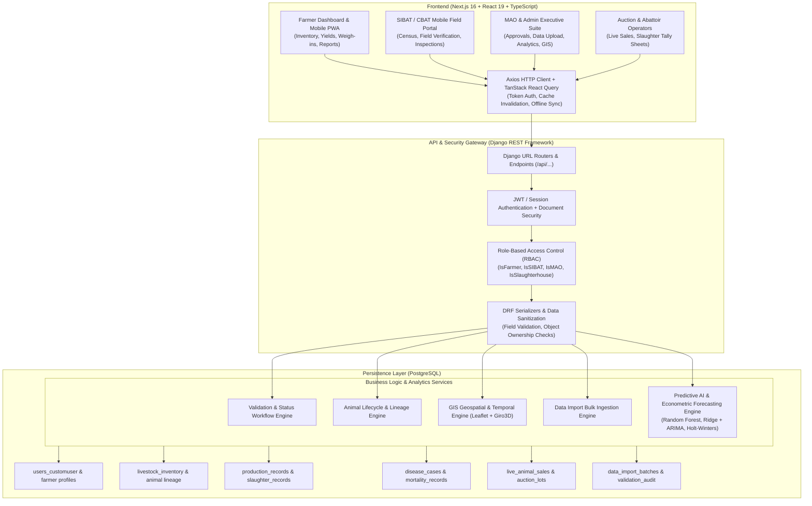
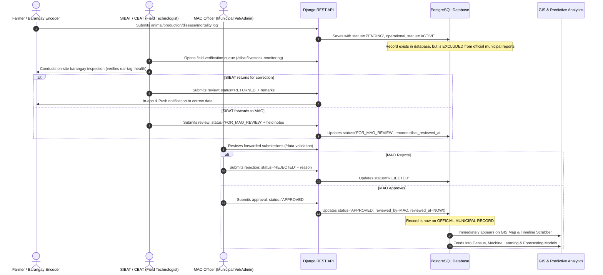
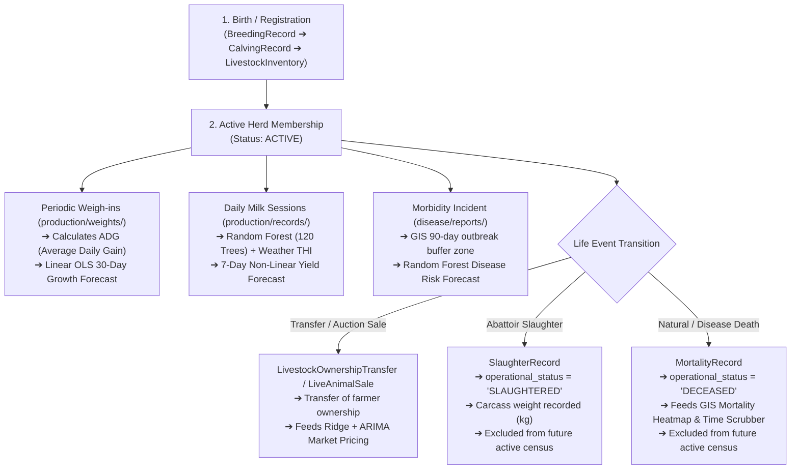
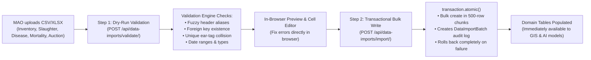
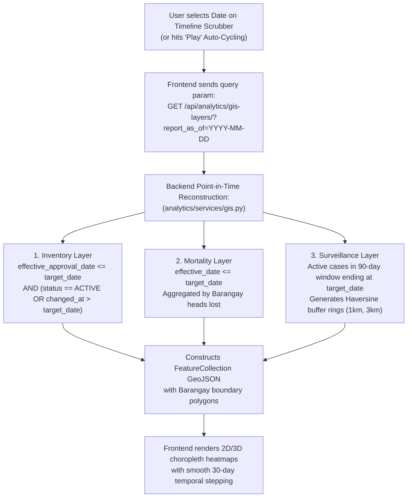

# SmartLivestock Complete End-to-End Data Flow Architecture

This document provides a comprehensive, unified blueprint of how data enters, moves through, is validated, and is analyzed across the entire **SmartLivestock** capstone system for Padre Garcia, Batangas.

---

## 1. High-Level Full-Stack System Architecture

---

## 2. The Core 2-Tier Validation Workflow (The Spine of the System)

Nothing becomes an official municipal record or enters government reports until it passes the **two-tier validation workflow**. This preserves data integrity across rural barangays:

---

## 3. Individual Animal Lifecycle & Lineage Data Flow

SmartLivestock tracks animals individually (`INDIVIDUAL` entry with unique ear tag) or in herds (`BATCH` entry with head count).

---

## 4. Bulk Data Ingestion Flow (Data Upload Feature)

For historical data migration from paper and legacy Excel spreadsheets:

---

## 5. GIS Geospatial & Temporal Playback Data Flow

The GIS module combines 2D interactive cartography (Leaflet) and 3D terrain rendering (Giro3D) across 21 barangays of Padre Garcia:

---

## 6. Predictive Analytics & AI Data Flow

SmartLivestock does not rely on a single algorithm; it routes each specific agricultural problem to its mathematically appropriate model:

```mermaid
flowchart TD
    subgraph Pipeline_1 ["Individual Cow Daily Milk Forecast (livestock_milk.py)"]
        P1_In["Inputs:<br/>• 30+ daily milking logs (lags t-1, t-2, t-3, t-7, roll_7)<br/>• Cow traits: weight_kg, age_years, breed, days_since_calving<br/>• Open-Meteo weather: prior-day temp & humidity (THI)"]
        P1_Eval["Chronological Holdout Tournament (80/20 Date Split):<br/>Compares Naive vs Linear Regression vs Random Forest"]
        P1_Model["RandomForestRegressor(n_estimators=120, max_depth=7)<br/>Learns non-linear biological lactation curve & heat stress thresholds"]
        P1_Out["7-Day Out-of-Sample Daily Forecast (Liters)"]
        P1_In --> P1_Eval --> P1_Model --> P1_Out
    end

    subgraph Pipeline_2 ["Cattle Market Pricing Hybrid Engine (cattle_price.py)"]
        P2_In["Cattle Profile Inputs:<br/>Breed, Sex, Weight (kg), Age (months)"]
        P2_Stage1["Stage 1: Ridge Regression (alpha=10)<br/>Resolves multicollinearity between age and weight to compute baseline trait price"]
        P2_Stage2["Stage 2: ARIMA(1,0,1) Residual Time-Series<br/>Models macro market price momentum from past auction weeks"]
        P2_Gate["Holdout Gatekeeper:<br/>Hybrid must beat simple baseline MAE in walk-forward backtest"]
        P2_Out["Estimated Market Value (PHP) + 3-Month Trajectory"]
        P2_In --> P2_Stage1 --> P2_Stage2 --> P2_Gate --> P2_Out
    end

    subgraph Pipeline_3 ["Municipal Macro Commodity & Disease Forecasts (forecasting.py)"]
        P3_In["Approved Monthly Municipal Aggregates<br/>(Milk liters, Abattoir carcass kg, Disease cases, Mortality heads)"]
        P3_Tourney["Automated Benchmark Tournament:<br/>Naive vs Seasonal-Naive vs Linear vs Random Forest (50) vs ARIMA vs Holt-Winters"]
        P3_Select["Selects Candidate with Lowest Rolling-Origin MAE/RMSE<br/>(Advanced model must beat Naive Baseline to be deployed)"]
        P3_Out["6-Month Out-of-Sample Horizon with Prediction Intervals"]
        P3_In --> P3_Tourney --> P3_Select --> P3_Out
    end
```

---

## Summary of Subsystem Integration

| Domain | Ingestion Channel | Validation Authority | Storage Model | Downstream Consumption |
| :--- | :--- | :--- | :--- | :--- |
| **Animals** | Farmer entry / Bulk CSV | SIBAT verification ➔ MAO approval | `LivestockInventory` | GIS Inventory Layer, Census, Lineage, Weigh-in ADG |
| **Dairy Milk** | Farmer daily session | SIBAT verification ➔ MAO approval | `ProductionRecord` | Random Forest 7-day forecast, Farm revenue charts |
| **Slaughter Meat** | Abattoir staff tally / Bulk CSV | MAO approval | `SlaughterRecord` | Municipal meat yield analytics, Time-series ARIMA |
| **Disease Cases** | Farmer observation / CBAT log | SIBAT field check ➔ MAO Vet | `DiseaseCase` | 90-day GIS Outbreak Rings, Random Forest morbidity ML |
| **Mortalities** | Farmer log / CBAT casualty report | SIBAT field check ➔ MAO approval | `MortalityRecord` | Changes animal to `DECEASED`, GIS Mortality Timeline |
| **Auction Sales** | Auction gate staff entry / Bulk CSV | MAO approval | `LiveAnimalSale` | Ridge + ARIMA price-by-profile, Weekly market volume |
